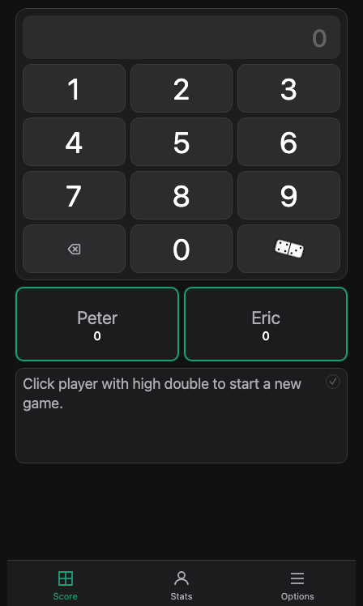
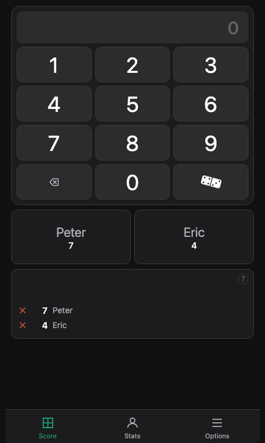
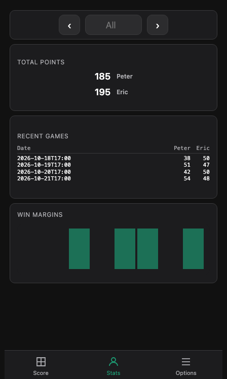
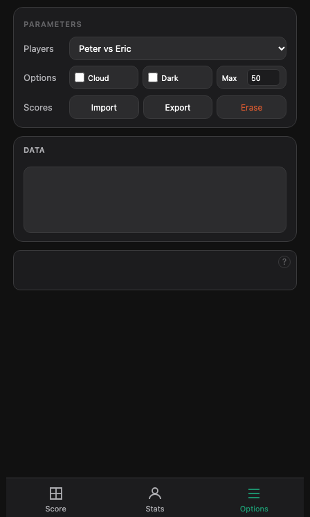
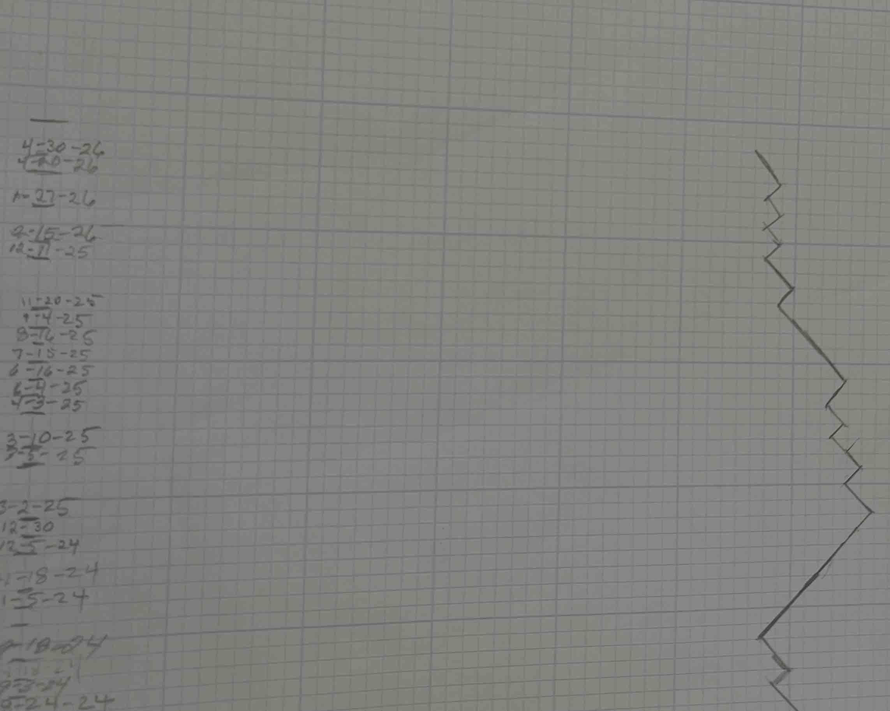
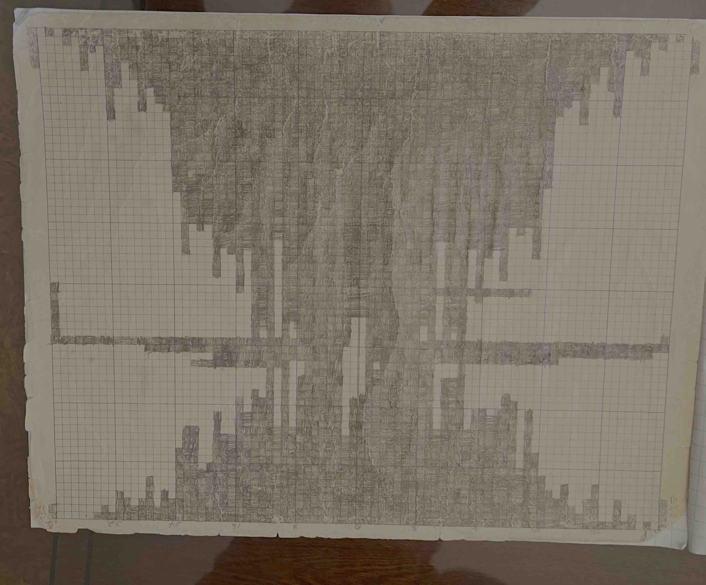
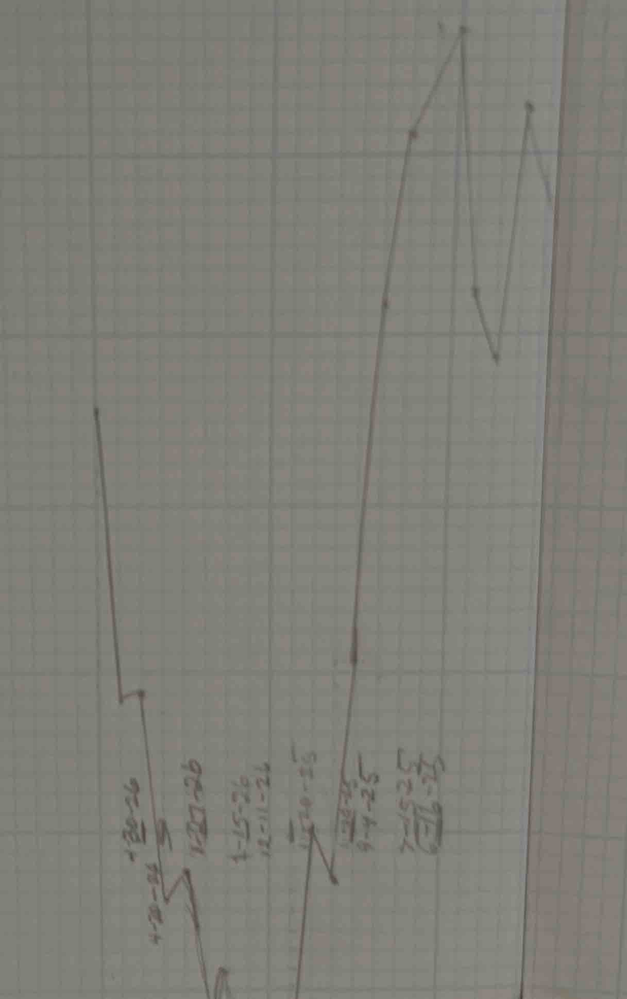
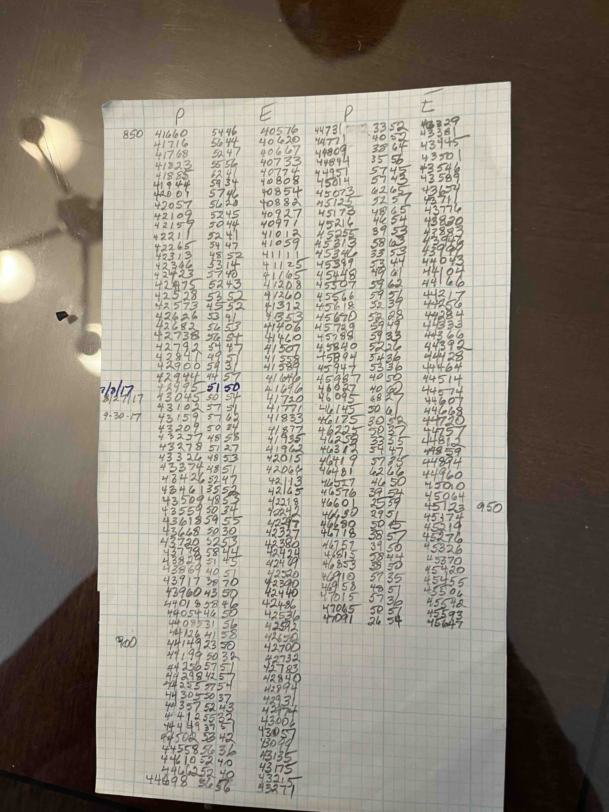

# Dominoes Scorekeeper

A lightweight browser-based scorekeeper for domino games. Record games quickly, compare player performance over time, and explore trends with simple, mobile-friendly analytics.

## Usage

Visit:

https://evanvliet.github.io/dominoes

You will see the main scoring tab. At the start of a game, tap the player who has the highest double; that player starts. Type `?` (or tap the help icon) for instructions. Help and status messages use larger text for readability. Who starts alternates on each hand.



At the start of a game, both player tiles show a green dot until you select who has the highest double. The keypad is disabled until you select a player; clicking it or elsewhere on the score screen shows the starting instructions. The status box confirms who goes first. After selecting the starting player, add scores by entering a number and clicking on the scorer.
After some play, the status lists recent scores.
Click the red **X** to delete a score, and possibly replace by adding another score.



When a player *dominoes* (plays all their tiles), the hand ends. First, enter any score from that play, then tap the domino tile below the **9** to mark the hand complete. The status area reports hand totals and who goes first next; player tiles are not highlighted during play. The message remains until the next click, which also performs its normal action and restores the recent-score display.
After a domino, the player with the most points above the top score wins. The status area reports the winner and final score. Tap a player with the highest double to begin the next game.

The middle tab is STATS; when games span at least three distinct years, it has a year filter (All or a year with recorded games). Use the arrows to move through years; the year field also accepts a year with recorded games. Double-click the year field to cycle forward at one-second intervals. It starts at the earliest year when All is selected, stops at the last year, and any click stops it at the year currently shown. Click the first section to cycle through points, averages, and games. The middle cycles through graphs of game and point scores, then all completed games in chronological date-and-score order. The history opens at the latest game; press `k` to scroll toward the past and `j` toward the future. The third has three histograms; click to see winning margins for each player, and another for both.

Screenshots: 

| Statistics | Options |
| :--- | :--- |
|  |  |

Last is Options: set up separate contests labeled by player names. Choose **New...** from **Players**, then enter both player names in the Data box. Choose **Download...** to make a local copy of a shared contest. The Parameters box also configures top score, cloud sharing, and dark mode. Scores can be imported or exported with the shared Data and Status boxes.

### Web App

Browsers can install the app to your home screen
for a more native experience:
* Android (Chrome): Go to the site, tap the three dots beside
the address bar, and select Add to Home screen.
* iOS (Safari): Go to the website, tap the Share button at
the bottom of the screen, and select Add to Home Screen.

### Data

Options has one shared Data box for player names, import/export data, and cloud sheet details. The Data and Status boxes remain the same size as their contents change; scroll inside them when necessary.
The three score actions operate on the selected contest.
* *Export* shows current contest data in the Data box and copies it to the clipboard:

    ```text
    Date,Host,Guest
    1978-01-02T18:00,51,49
    1978-01-03T18:00,54,31
    ```

First player names header, followed by date, time and player scores for each completed game. You have to paste the clipboard data into a mail message or web document to save it.
* *Import* first switches Data to score-entry mode. Paste data and select Import again to add
  scores to the currently selected contest. If a timestamp already exists, the existing local
  score is kept. Status reports how many records were added out of those supplied. For testing,
  you can import 75 scores from [test75](test75).
* *Erase* removes the selected contest and its cloud link from this device after confirmation. It does not erase the server copy; use **Download...** with the sheet name and both player names to restore a local copy.

To create a shared score sheet, deploy [code.gs](code.gs) as an Apps Script web app at the endpoint configured in [index.html](index.html), then enable **Cloud** for a contest and choose a hard-to-guess sheet name. Treat that name as a password: anyone with it and both player names can download and add scores. The server creates a three-column sheet with room for 500 scores plus its header row, then adds rows as needed.

Completed games are uploaded when possible, and linked contests sync with the server at startup or when selected, at most once per day. Cloud updates are append-only. An identical score at an existing minute is ignored; if the same minute already has different scores, the server's record is kept. Cloud scores cannot be edited or erased from the app. A local erase removes the local contest and its link only; downloading it again creates a local copy of the latest server scores.

The server reads ISO timestamps, spreadsheet date cells, and legacy JavaScript date strings in the Date column. Redeploy [code.gs](code.gs) after updating it so the web app uses the current script.

## Why This Exists

Long time friend Peter and I have played dominoes for years. We kept scores on scraps of paper, and graphs on sheets of graph paper taped together. Here's a gallery of those:

| Games / Points | Histogram / Scores |
|-|-|
||. |
|||

We would scheme on an alternative to pencil-and-paper scorekeeping: a fast, browser-based alternative that preserves game history and reveals who is really winning over time. It would:

* Preserve game history permanently
* Track lifetime statistics automatically
* Surface winning trends and rankings
* Provide useful charts and insights
* Run in any modern browser

The arrival of AI coding tools was too tempting, and this is the result.

### More info
See [prompts](prompts.md) for the initial development logs.
And [info](info.md) has AI genearted feature details.
