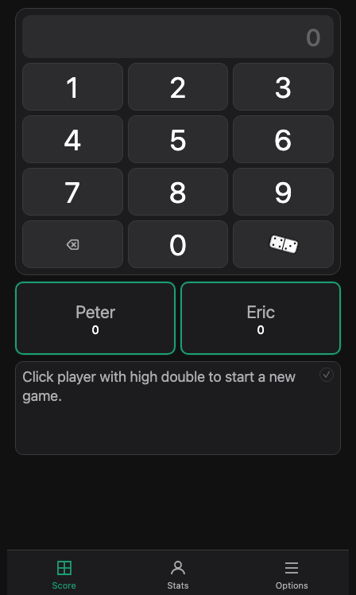
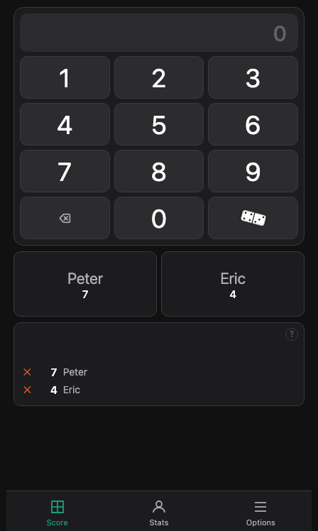
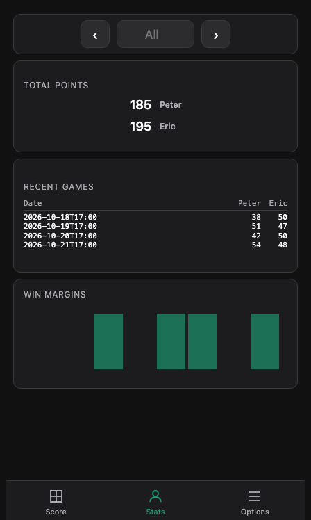
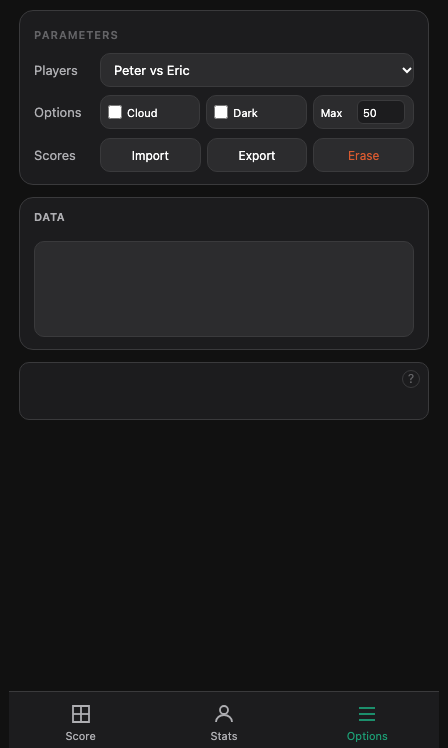
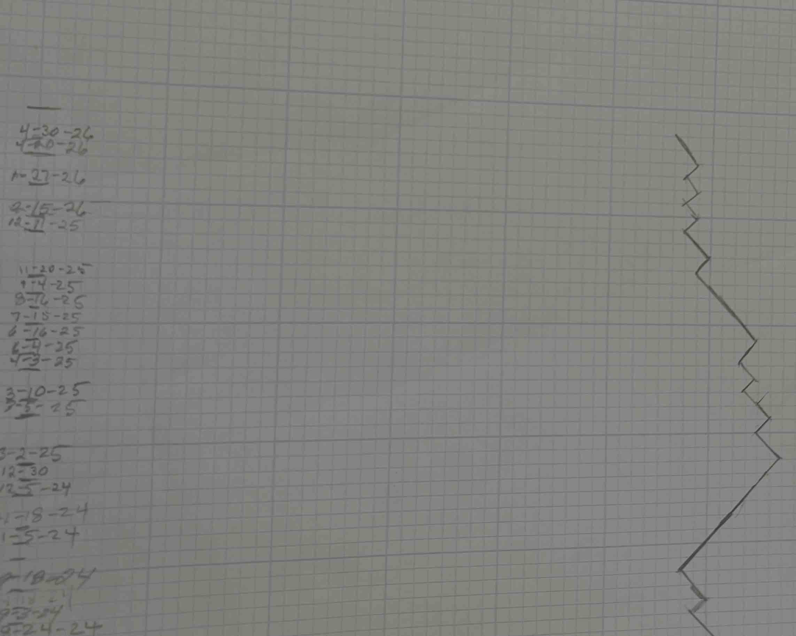
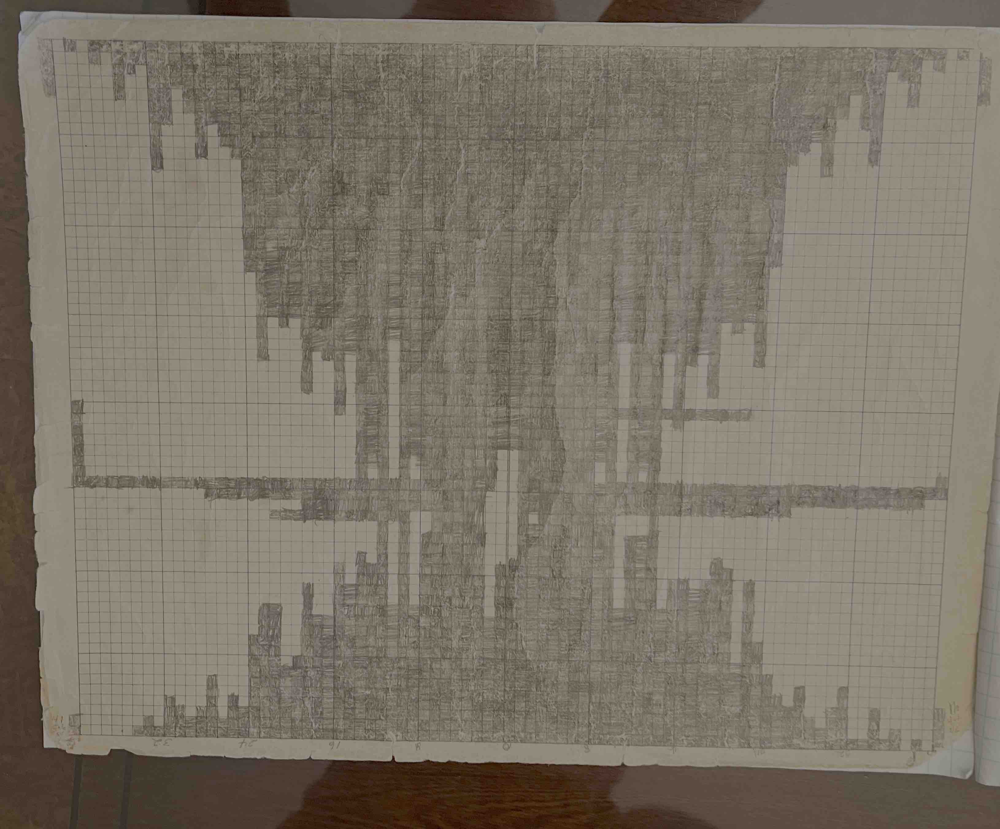
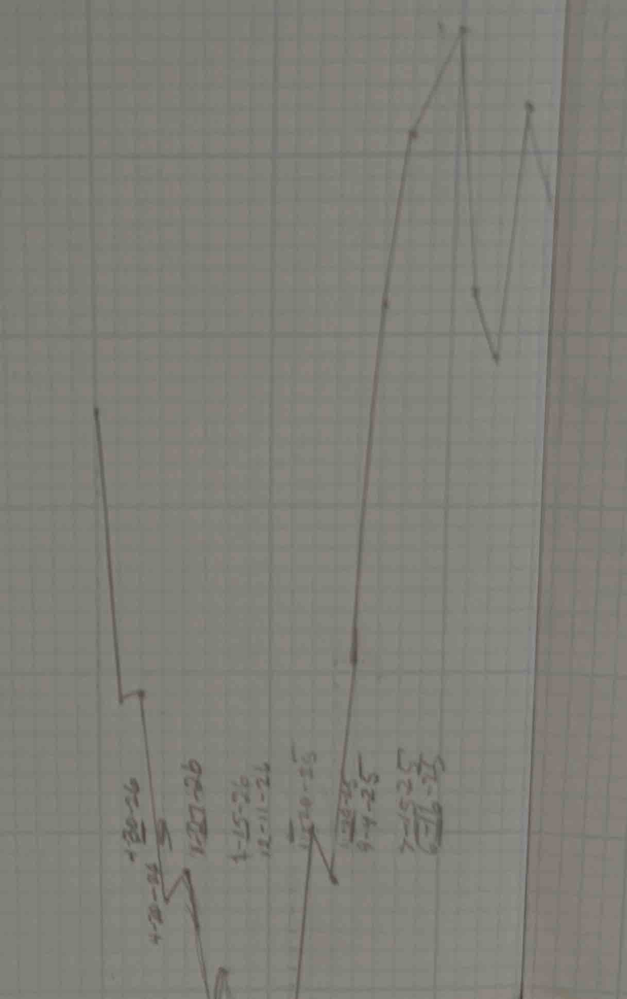
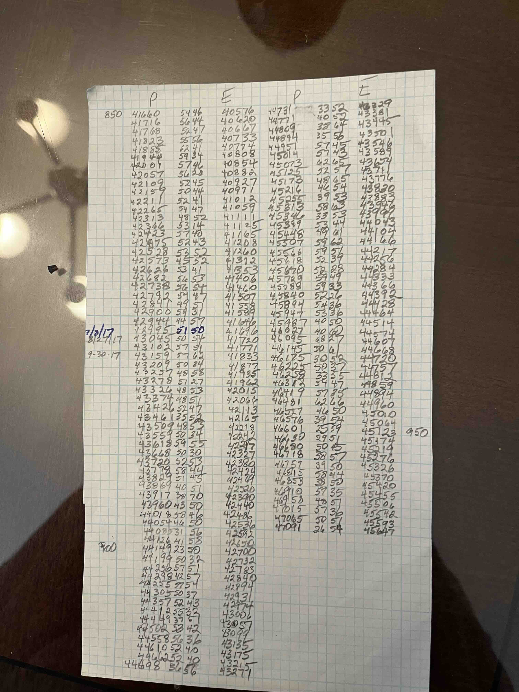

# Dominoes Scorekeeper

A lightweight browser-based scorekeeper for domino games. Record games quickly, compare player performance over time, and explore trends with simple, mobile-friendly analytics.

## Usage

Visit:

https://evanvliet.github.io/dominoes

You will see the main scoring tab. At the start of a game, tap the player who has the highest double; that player starts. Type `?` (or tap the help icon) for instructions. Help and status messages use larger text for readability. Who starts alternates on each hand.



At the start of a game, both player tiles are highlighted until you select who has the highest double. The keypad is disabled until you select a player. The status box confirms who goes first. After selecting the starting player, add scores by entering a number and clicking on the scorer.
After some play, the status lists recent scores.
Click the red **X** to delete a score, and possibly replace by adding another score.



When a player *dominoes* (plays all their tiles), the hand ends. First, enter any score from that play, then tap the domino tile below the **9** to mark the hand complete. The status area reports hand totals and who goes first next; player tiles are not highlighted during play.
After a domino, the player with the most points above the top score wins. The status area reports the winner and final score. Tap its checkmark to clear the message, then tap the player with the highest double to begin the next game.

The middle tab is STATS; when games span at least three distinct years, it has a year filter (All or a year with recorded games). Use the arrows to move through years; the year field also accepts a year with recorded games. Click the first section to cycle through points, averages, and games. The middle cycles through graphs of game and point scores, then all completed games in chronological date-and-score order. The history opens at the latest game; press `k` to scroll toward the past and `j` toward the future. The third has three histograms; click to see winning margins for each player, and another for both.

Screenshots: 

| Statistics | Options |
| :--- | :--- |
|  |  |

Last is Options: set up separate contests labeled by player names. Choose **New contest...** or use **Players**, then enter both player names in the Data box. The Parameters box also configures top score, cloud backup, and dark mode. Scores can be imported or exported with the shared Data and Status boxes.

### Web App

Browsers can install the app to your home screen
for a more native experience:
* Android (Chrome): Go to the site, tap the three dots beside
the address bar, and select Add to Home screen.
* iOS (Safari): Go to the website, tap the Share button at
the bottom of the screen, and select Add to Home Screen.

### Data

Options has one shared Data box for player names, import/export data, and a cloud backup URL.
The three score actions operate on the selected contest.
* *Export* shows current contest data in the Data box and copies it to the clipboard:

    ```text
    Date,Host,Guest
    1978-01-02T18:00,51,49
    1978-01-03T18:00,54,31
    ```

First player names header, followed by date, time and player scores for each completed game. You have to paste the clipboard data into a mail message or web document to save it.
* *Import* first switches Data to score-entry mode. Paste data and select Import again to add
  scores to the currently selected contest. If a timestamp already exists, the existing local
  score is kept. Status reports how many records were added out of those supplied. For testing,
  you can import 75 scores from [test75](test75).
* *Erase* deletes the selected contest's scores from this device and, when cloud backup is on,
  from the server, after confirmation.

To use cloud backup for a contest, deploy the current [code.gs](code.gs) as an Apps Script web app
and switch on **Cloud backup** in that contest's Parameters. The saved URL (or the last verified
URL) appears in Data; select Check/Update, then confirm the successful connection in Status.
Each contest remembers its own Local/Cloud choice and URL. Newly created contests start in Local
mode and can reuse the last verified URL when Cloud is enabled. Existing app-wide backup settings
are copied to existing contests the first time the updated app loads.
Completed games are uploaded when possible; the active cloud-backed contest is reconciled with
the server at startup or when selected, at most once per day. Sync merges by contest and minute-level timestamp:
local scores win timestamp conflicts, cloud-only scores are added locally, and local-only or
conflicting local scores are sent to the server. The server keeps at most one score record per
contest timestamp and sorts records by date. Therefore, two games in the same contest during
the same minute resolve to one record at sync time.

## Why This Exists

Long time friend Peter and I have played dominoes for years. We kept scores on scraps of paper, and graphs on sheets of graph paper taped together. Here's a gallery of those:

| Games / Points | Histogram / Scores |
|-|-|
||. |
|||

We would scheme on an alternative to pencil-and-paper scorekeeping: a fast, browser-based alternative that preserves game history and reveals who is really winning over time. It would:

* Preserve game history permanently
* Track lifetime statistics automatically
* Surface winning trends and rankings
* Provide useful charts and insights
* Run in any modern browser

The arrival of AI coding tools was too tempting, and this is the result.

### More info
See [prompts](prompts.md) for the initial development logs.
And [info](info.md) has AI genearted feature details.
